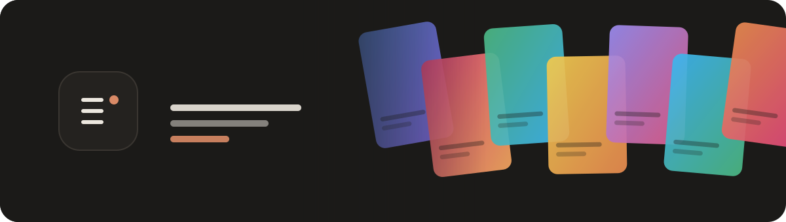
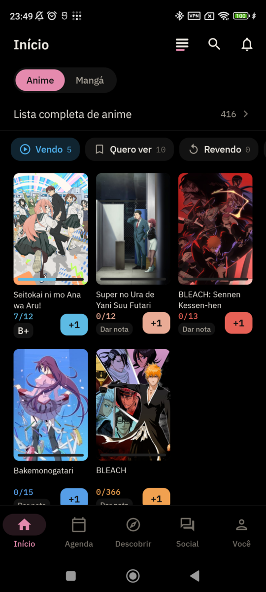
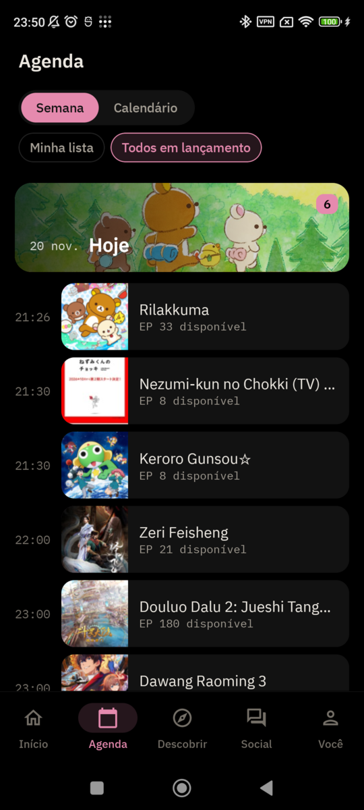
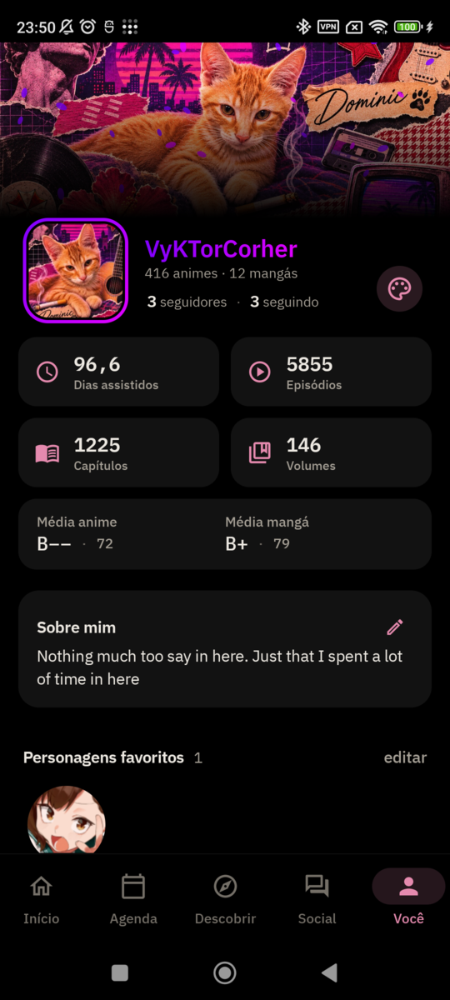
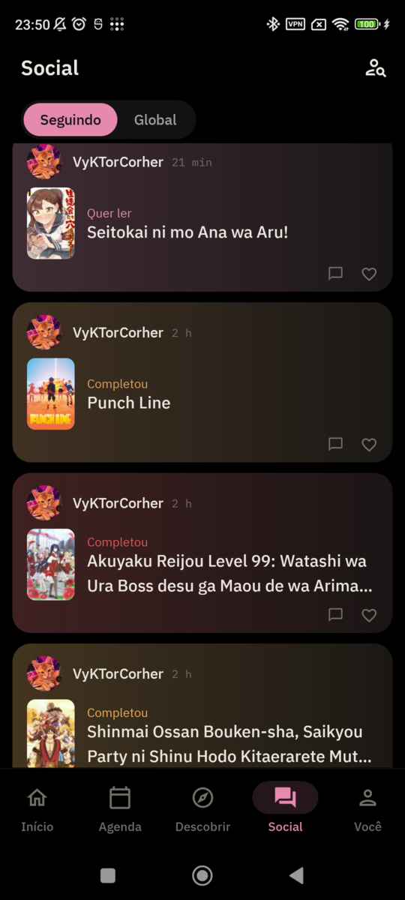
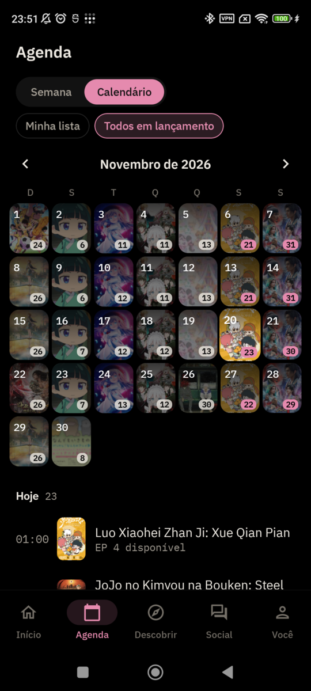

<div align="center">



<h1>Listonatha</h1>

<p><b>Sua lista de animes e mangás do AniList, no bolso.</b><br/>
Marque episódios num toque, dê notas do seu jeito, saiba o que sai hoje e acompanhe seus amigos.</p>

<a href="https://github.com/Vicente-PIlonetto/Listonatha/releases/latest"></a>


</div>

<br/>

<p align="center">
  <br/>
  <sub><a href="docs/video/listonatha.mp4">Assistir com som</a></sub>
</p>

<p align="center">
  
  
  
  
</p>

## Por que o Listonatha

O AniList é ótimo para organizar o que você assiste e lê, mas no celular o dia a dia pede algo mais rápido. O Listonatha foi feito para isso: abrir, marcar o episódio que acabou de ver e voltar para a vida. Tudo que você faz aparece igual no site, e o que você muda no site aparece no app.

## O que ele faz

<table>
<tr>
<td width="80" align="center"></td>
<td><b>Acompanhe sem esforço</b><br/>
Um toque no +1 e o episódio ou capítulo está marcado. O Início separa o que você está <i>vendo</i>, <i>quer ver</i>, <i>revendo</i> e <i>pausou</i>, e destaca quando há episódio novo esperando por você. A ordem dessas categorias é sua: escolha qual vem primeiro e quais aparecem como aba. Segurando o dedo numa capa, você muda o status ou dá nota sem abrir nada.</td>
</tr>
<tr>
<td align="center"></td>
<td><b>Notas do seu jeito</b><br/>
Letras (de F a A++), 5 estrelas, carinhas coloridas (do vermelho de "Detestei" ao verde de "Adorei"), de 0 a 10 ou de 0 a 100. E as notas especiais, de S até SSS+++, para aquela obra que merece mais que a nota máxima. Dá para mostrar duas escalas ao mesmo tempo.</td>
</tr>
<tr>
<td align="center"></td>
<td><b>Nunca perca um episódio</b><br/>
A Agenda mostra o que sai na semana, dia a dia, e o calendário do mês inteiro, com a capa de cada dia. Você escolhe ver só a sua lista ou tudo que está em lançamento, e pode receber um aviso quando sair episódio novo.</td>
</tr>
<tr>
<td align="center"></td>
<td><b>Ache o próximo favorito</b><br/>
Em alta, temporada atual e a próxima, recomendações a partir das suas melhores notas, filtros por gênero e por nichos como isekai e iyashikei, e um botão de sortear para quando bater a dúvida. Cada obra mostra onde assistir e abre direto no app do serviço.</td>
</tr>
<tr>
<td align="center"></td>
<td><b>Seus números</b><br/>
Quantos animes e mangás, episódios e capítulos, dias assistidos e planejados, sua nota média e como suas notas se distribuem, já no sistema de nota que você usa. Também mostra status, formatos e os gêneros que você mais vê. Vale para o seu perfil e para o de qualquer pessoa.</td>
</tr>
<tr>
<td align="center"></td>
<td><b>Leia e assista no app que você já usa</b><br/>
Se você tem o Komikku, o Mihon ou o Aniyomi, a página da obra mostra <i>Ler em</i> ou <i>Assistir em</i> e abre a busca dele já com o título. E o botão de compartilhar manda a obra para um amigo com o link do AniList.</td>
</tr>
<tr>
<td align="center"></td>
<td><b>Junto com os amigos</b><br/>
Veja o que seus amigos estão vendo, curta, responda e publique. Abra a lista completa de qualquer pessoa, com as notas no formato que ela usa no AniList. O fórum do AniList está no app, por categoria se você preferir, e cada obra mostra quem você segue que também está nela, com a nota de cada um.</td>
</tr>
<tr>
<td align="center"></td>
<td><b>Do seu jeito</b><br/>
Tema claro, escuro ou preto, cor de destaque e um ícone que combina. No perfil: banner, cores especiais, fundos animados, bio e seus personagens favoritos.</td>
</tr>
<tr>
<td align="center"></td>
<td><b>Funciona sem internet</b><br/>
Marcou um episódio no metrô? Fica salvo no celular e vai para o AniList assim que a conexão voltar, na ordem em que você fez.</td>
</tr>
<tr>
<td align="center"></td>
<td><b>Em 9 idiomas</b><br/>
Português, inglês, espanhol, francês, alemão, italiano, russo, japonês e chinês. Sinopses e fichas de personagens podem ser traduzidas no próprio celular, sem mandar o texto para fora.</td>
</tr>
</table>

<p align="center">
  
  
  
  
</p>

## Como instalar

1. Baixe o arquivo **Listonatha.apk** na [página de versões](https://github.com/Vicente-PIlonetto/Listonatha/releases/latest).
2. Abra o arquivo no celular. Se o Android pedir, permita **instalar apps desconhecidos** para o navegador ou para o app de arquivos.
3. Abra o Listonatha e toque em **Entrar com AniList**.

Para atualizar, baixe a versão nova e instale por cima. Sua lista, notas e configurações continuam lá.

## Primeiros passos

- **Escolha seu sistema de notas** em *Configurações > Sistemas de nota*. Se você usa letras, as notas especiais aparecem no seletor.
- **Ligue os avisos** em *Configurações > Notificações* para saber quando sai episódio do que você está vendo.
- **Arrume as categorias** em *Configurações > Listas e títulos > Ordem das categorias*. A ordem vale para o Início e para a lista completa.
- **Marque seus serviços de streaming** para eles aparecerem primeiro em "Onde assistir".
- **Veja suas estatísticas** em *Você > Ver estatísticas*.
- **Deixe com a sua cara** em *Você > Personalizar*.

## Perguntas frequentes

**Preciso de conta?**
Sim, uma conta do [AniList](https://anilist.co), que é gratuita. Sua lista fica lá.

**Minha senha passa pelo app?**
Não. O login acontece na página do próprio AniList, e o app recebe só uma autorização guardada de forma cifrada no celular.

**Posso usar mais de uma conta?**
Pode. Em *Configurações > Contas* você troca entre elas.

**E conteúdo adulto?**
Fica escondido por padrão. Se você ativar, as capas aparecem desfocadas até você desligar essa opção.

**Por que não está na Play Store?**
É um projeto pessoal e gratuito. A instalação é pelo arquivo, como descrito acima.

## Privacidade

O Listonatha conversa só com o AniList. Não há anúncios, contas próprias nem coleta de dados. As imagens que você escolhe da galeria para o perfil e as notas especiais ficam apenas no seu celular, e podem ser salvas num backup em *Configurações > Backup*.

## Apoie o projeto

O Listonatha é gratuito, sem anúncios e de código aberto. Se ele te ajuda e você quiser contribuir, qualquer valor pelo Pix vale. No app, fica em *Configurações > Sobre > Apoiar o projeto (Pix)*.

<p align="center"></p>

Pix copia e cola:

```
00020126580014br.gov.bcb.pix0136274972f2-15d1-406e-b968-a072d0b6fbaf5204000053039865802BR5917Vicente Pilonetto6009Concordia62070503***630408C6
```

Chave aleatória: `274972f2-15d1-406e-b968-a072d0b6fbaf` (Vicente Pilonetto)

## Encontrou um problema ou tem uma ideia?

Abra uma [issue](https://github.com/Vicente-PIlonetto/Listonatha/issues/new/choose): há modelos para relatar um erro ou sugerir uma ideia. Quer ajudar com código ou tradução? Veja o [guia de contribuição](CONTRIBUTING.md).

## Licença

Distribuído sob a [GNU GPL 3.0](LICENSE). Você pode usar, estudar, modificar e compartilhar; versões modificadas que forem distribuídas também precisam ter o código aberto.

<div align="center">
<br/>
<sub>Dados do <a href="https://anilist.co">AniList</a>. O Listonatha não é afiliado ao AniList.<br/>
Fontes IBM Plex Sans e IBM Plex Mono, sob a SIL Open Font License.</sub>
</div>
