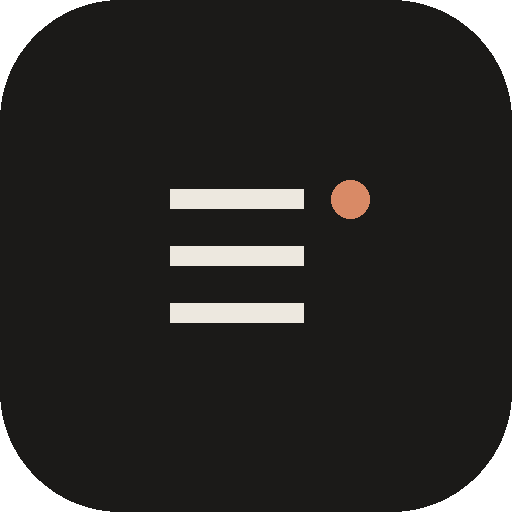
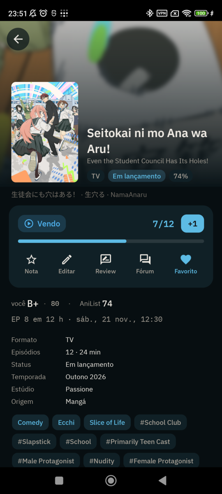
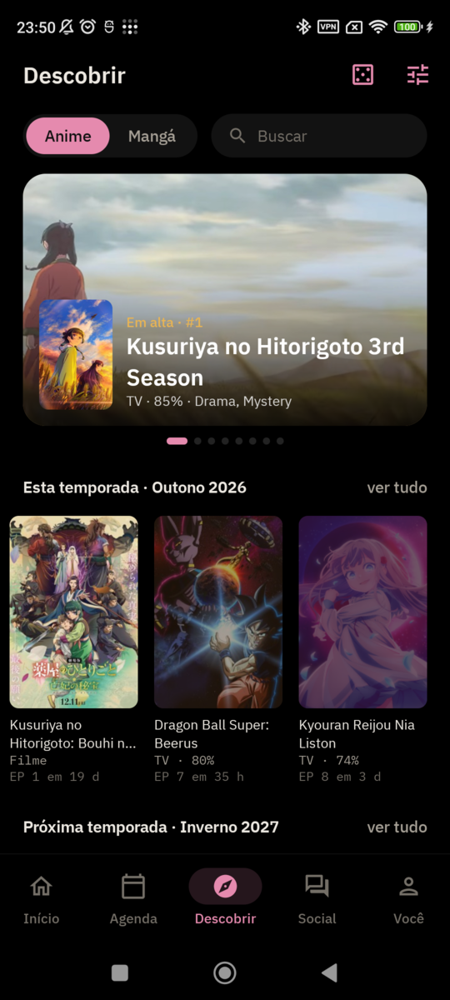
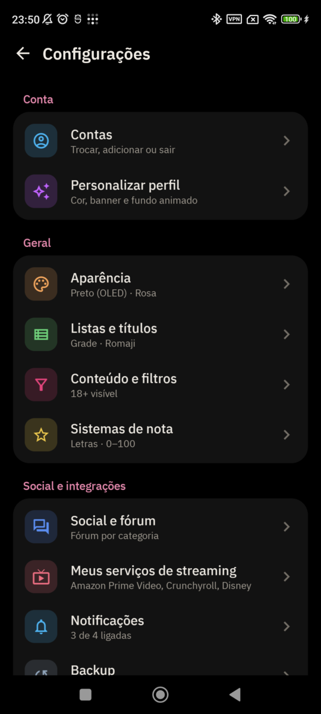

# Listonatha

**Sua lista de animes e mangás do AniList, no bolso.**
Marque episódios, dê notas do seu jeito, veja o que sai hoje e acompanhe seus amigos.

  
  
  
  

---

## ✦ O que ele faz

<table>
<tr>
<td width="50%" valign="top">

### 📺 Acompanhe sem esforço
Um toque no **+1** e o episódio está marcado. O Início separa o que você está **vendo**, **quer ver** e **revendo**, e mostra quando tem episódio novo esperando.

</td>
<td width="50%" valign="top">

### ⭐ Notas do seu jeito
Letras, estrelas, carinhas ou de 0 a 100. E as notas especiais, de **S** até **SSS+++**, para aquele anime que merece mais que nota máxima.

</td>
</tr>
<tr>
<td valign="top">

### 📅 Nunca perca um episódio
A **Agenda** mostra o que sai na semana e no mês, com a capa de cada dia. Se quiser, o app avisa quando sair episódio novo do que você está vendo.

</td>
<td valign="top">

### 🧭 Ache o próximo favorito
Em alta, temporada atual e próxima, recomendações a partir das suas melhores notas, filtros por gênero e um botão de **sortear** para quando bater a dúvida.

</td>
</tr>
<tr>
<td valign="top">

### 💬 Junto com os amigos
Veja o que seus amigos estão assistindo, curta, responda, poste e participe do **fórum** do AniList, sem sair do app.

</td>
<td valign="top">

### 🎨 Do seu jeito
Tema claro, escuro ou preto, cor de destaque, ícone que combina, banner, cores especiais e **fundos animados** no perfil.

</td>
</tr>
<tr>
<td valign="top">

### 📶 Funciona sem internet
Marcou um episódio no metrô? Fica salvo e vai para o AniList assim que a conexão voltar, na ordem certa.

</td>
<td valign="top">

### 🌎 Em 9 idiomas
Português, inglês, espanhol, francês, alemão, italiano, russo, japonês e chinês. Sinopses e fichas de personagens podem ser traduzidas no próprio celular.

</td>
</tr>
</table>

  
  
  
  

---

## ⬇️ Como instalar

1. Baixe o arquivo **Listonatha.apk** na [página de versões](https://github.com/Vicente-PIlonetto/Listonatha/releases/latest).
2. Abra o arquivo no celular. Se o Android pedir, permita **instalar apps desconhecidos**.
3. Abra o Listonatha e toque em **Entrar com AniList**.

Para atualizar, é só instalar a versão nova por cima: nada se perde.

## 🙋 Perguntas rápidas

**Preciso de conta?** Sim, uma conta do [AniList](https://anilist.co), que é gratuita. Sua lista fica lá e aparece igual no site.

**Minha senha passa pelo app?** Não. O login acontece na página do próprio AniList.

**Posso usar mais de uma conta?** Pode. Em *Configurações > Contas* dá para trocar entre elas.

**Tem conteúdo adulto?** Fica escondido por padrão. Se você ativar, as capas aparecem desfocadas até você decidir o contrário.

---

Dados do <a href="https://anilist.co">AniList</a>. O Listonatha não é afiliado ao AniList. 
Quer compilar ou contribuir? Veja o <a href="docs/DESENVOLVIMENTO.md">guia de desenvolvimento</a>.

